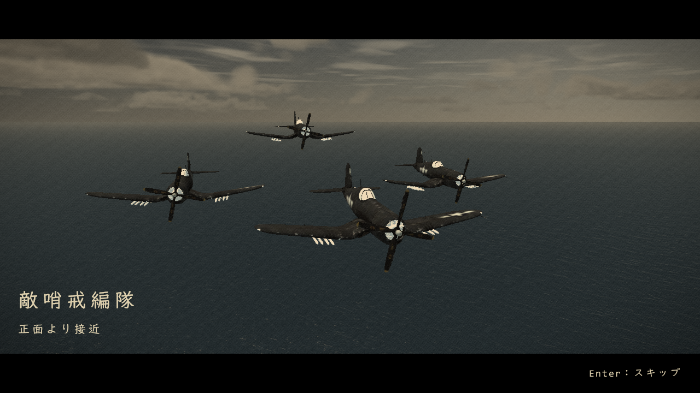

# SkyMission

**零戦で敵編隊を突破し、艦隊の中核を狙う3Dフライトアクション。**

C++20とDirectX 12で開発したWindows向けのゲームです。

## どんなゲームか

1945年の太平洋を舞台に、基地へ迫る艦隊を単機で迎撃します。
敵の哨戒機を撃墜し、空母をロックオンして対艦ミサイルで攻撃します。空母を撃破した後は、増援や編隊長機との空戦に移ります。

## 実装の見どころ

- **飛行と空戦** — 推力・揚力・抗力を使って機体を動かします。敵機は機体ごとに異なる経路で接近と離脱を繰り返し、プレイヤーは敵の未来位置を示す照準を使って射撃します。[敵機AIの設計](Docs/Design/EnemyTailPursuit.md) · [ロックオンと照準](Docs/Design/TargetLockCombatHud.md)
- **海と雲の描画** — 海は手前を細かく、遠方を粗く分割して、三角形数を約200万から約13万に削減しました。立体的な積雲は縦横1/3の解像度で計算し、深度を見ながら合成して機体や艦船の手前・奥を表現します。[描画の最適化](Docs/Design/RenderingPerformance.md) · [雲の描画](Docs/Design/VolumetricClouds.md)
- **入力と調整** — キーボード・マウスに加え、GameInputでXbox・DualShock 4・DualSenseの操作に対応します。射撃・加減速・撃破などで手応えを変え、振動の強さや間隔はJSONで調整できます。[振動設定](Assets/Combat/rumble.json) · [ゲーム設定の設計](Docs/Design/GameplaySettings.md)

## 遊び方

配布ZIPが手元にある場合は、展開して直下の `SkyMission.exe` を起動します。配布版の起動にSDKは不要です。

Visual Studio 2026で `SkyMission.slnx` をビルドするには、Windows SDK 10.0.26100.0以降と .NET 10 SDK 10.0.404以降が必要です。未導入の場合は、初回ビルドの前にインストールしてください。手順は[開発・操作ガイド](Docs/Guide.md#初回ビルドと起動)を参照してください。

タイトル画面で **Enter**、Xboxの **A**、またはPlayStationの **×** を押すと開始します。

| 操作 | キーボード・マウス | ゲームパッド |
| --- | --- | --- |
| 操縦 | W / A / S / D | 左スティック |
| 加速 / 減速 | Ctrl / Space | RT / LT または R2 / L2 |
| 機関砲 | 左クリック | Xbox A / PS4・PS5 × |
| 対艦ミサイル | 右クリック | Xbox B / PS4・PS5 ○ |

対艦ミサイルは、空母攻撃段階で母艦をロックオンすると発射できます。

## 開発資料

- [ビルド・配布・全操作・テスト](Docs/Guide.md) — Visual Studio 2026、Windows SDK、.NET 10のセットアップを含みます。
- [シーンのライフサイクル](Docs/Design/FlightSceneLifecycle.md) · [モデル処理とキャッシュ](Docs/Design/ModelProcessing.md) · [起動時の設定読み込みの計測](Docs/Benchmarks/SceneSettingsLoading.md)
